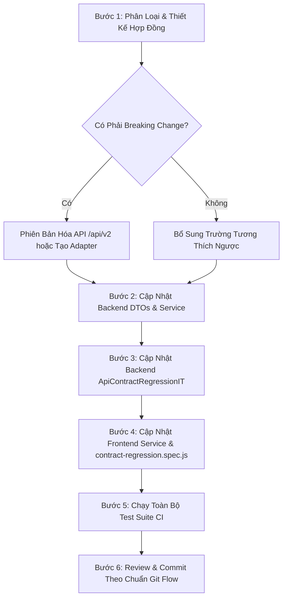

# API Contract Regression & Evolution Workflow

Tài liệu này chuẩn hóa quy trình quản lý, kiểm thử hồi quy (regression testing) và cập nhật API contracts giữa Backend (Spring Boot 3.3.6) và Frontend (Vue 3 / Vite) cho nền tảng Japanese Learning Web.

---

## 1. Chuẩn Hóa Response Envelope & Error Codes

Mọi API RESTful trong hệ thống bắt buộc phải tuân theo cấu trúc bao gói thống nhất `ApiResponse<T>`:

### 1.1 Success Response Envelope (`HTTP 200 / 201`)
```json
{
  "code": 1000,
  "message": "Thông báo thân thiện hoặc mô tả thao tác",
  "result": { ... } // hoặc null nếu response type là Void
}
```
*Frontend Handler:* `isApiSuccess(response)` kiểm tra `data.code === 1000`, `getApiResult(response, fallback)` trích xuất payload an toàn.

### 1.2 Error Response Envelope (`HTTP 400, 401, 403, 404, 409, 500`)
```json
{
  "code": 5005,
  "message": "Bạn không có quyền truy cập đơn hàng này"
}
```
- Không bao giờ trả về stack trace, thông tin hệ cơ sở dữ liệu nội bộ hoặc dữ liệu nhạy cảm.
- Mã lỗi nghiệp vụ (`code`) được định nghĩa tập trung trong enum `ErrorCode.java`.
- *Frontend Handler:* `getApiErrorCode(error)` và `getApiErrorPayload(error)` trích xuất trực tiếp mã lỗi nghiệp vụ để hiển thị UI tương ứng (ví dụ: cảnh báo đơn trùng lặp `5004`, từ chối quyền `5005` hay `3003`).

---

## 2. Chuẩn Hóa Cấu Trúc Phân Trang (Dual Pagination Standard)

Hệ thống hiện tại duy trì 2 định dạng phân trang có chủ đích và đã được bọc adapter tương thích:

| Module / API | Định Dạng Serialization | Cấu Trúc JSON Phản Hồi | Phía Frontend Tiêu Thụ |
| :--- | :--- | :--- | :--- |
| **Public Courses** (`GET /api/v1/courses`) & **Admin Courses** (`GET /api/v1/admin/courses`) | Spring Data `Page<T>` | `{ content: [...], number: 0, size: 10, totalPages: 1, totalElements: 5, first: true, last: true }` | `CourseListPage.vue` truy cập trực tiếp `res.data.result.content`, `number`, `totalPages`. |
| **Orders** (`GET /api/v1/orders/me`) & **Admin Users** (`GET /api/v1/admin/users`) | Custom `PageResponse<T>` | `{ currentPage: 0, pageSize: 10, totalPages: 1, totalElements: 5, data: [...] }` | `order.service.js` sử dụng adapter chuyển đổi sang mảng kèm metadata (`items.currentPage`, `items.pageSize`, `items.totalPages`, `items.totalElements`) giúp template `v-for` tương thích ngược hoàn toàn. |

> **Quy định bất biến:** Không được tự ý thay đổi tên trường `content` $\leftrightarrow$ `data` hoặc `number` $\leftrightarrow$ `currentPage` mà không cập nhật adapter và bộ test hồi quy tương ứng ở cả hai đầu.

---

## 3. Tính Toàn Vẹn Của Domain Enums & Serialized Values

Các enum bắt buộc phải được serialize dạng String chữ hoa (`EnumType.STRING` trong JPA) và đồng bộ với client:

1. **OrderStatus:** `PENDING`, `PAID`, `CANCELLED`, `EXPIRED`, `REFUNDED`
2. **PaymentMethod:** `VNPAY`, `MOMO`, `BANK_TRANSFER`
3. **PaymentStatus:** `PENDING`, `COMPLETED`, `FAILED`, `CANCELLED`
4. **CourseStatus:** `DRAFT`, `PUBLISHED`, `ARCHIVED`
5. **CourseLevel:** `N5`, `N4`, `N3`, `N2`, `N1`
6. **CourseType:** `FREE`, `PAID`
7. **EnrollmentStatus:** `ACTIVE`, `COMPLETED`, `CANCELLED`
8. **QuizAttemptStatus:** `IN_PROGRESS`, `SUBMITTED`, `TIMED_OUT`
9. **RoleName:** `STUDENT`, `TEACHER`, `ADMIN`, `SUPER_ADMIN`

---

## 4. Cô Lập Quyền Sở Hữu (Ownership Isolation) & Ma Trận Phân Quyền (RBAC)

Hệ thống thực thi nguyên tắc phòng thủ theo chiều sâu (Defense-in-Depth):

```
+-------------------------------------------------------------+
| Client Request (JWT Bearer Token / Role Claim)               |
+-------------------------------------------------------------+
                              |
                              v
+-------------------------------------------------------------+
| 1. Spring Security Filter & @PreAuthorize                   |
|    - Endpoint RBAC check (STUDENT, TEACHER, ADMIN)          |
|    - Unauthenticated -> 401 UNAUTHORIZED (1001)             |
|    - Role Mismatch   -> 403 FORBIDDEN (1002)                |
+-------------------------------------------------------------+
                              |
                              v
+-------------------------------------------------------------+
| 2. Domain Service Ownership Validation                       |
|    - Order Isolation: `order.user.id == currentUser.id`     |
|      -> 403 ORDER_ACCESS_DENIED (5005)                      |
|    - Learning Isolation: User must be ENROLLED in course    |
|      -> 403 FORBIDDEN_ACCESS (3003)                         |
|    - Quiz Attempt Isolation: `attempt.user.id == user.id`   |
|      -> 403 QUIZ_ATTEMPT_FORBIDDEN (4021)                   |
|    - Duplicate Pending Order Guard                          |
|      -> 409 ORDER_DUPLICATE_PENDING (5004)                  |
|    - Direct Paid Course Direct Enrollment Block             |
|      -> 400 COURSE_CANNOT_ENROLL_PAID (4008)                |
+-------------------------------------------------------------+
```

---

## 5. Danh Mục Test Hồi Quy Hợp Đồng (Contract Regression Suite)

Hệ thống được bảo vệ bởi 2 bộ test hợp đồng tự động chạy trong CI/CD:

### 5.1 Backend: `com.japaneselearning.contract.ApiContractRegressionIT` (34 test cases)
- **Nhóm 1 - Envelope Conformance:** Kiểm tra cấu trúc chuẩn `{code, message, result}` cho 200, 400 validation error, 401 unauthenticated, 403 role forbidden, 404 resource not found.
- **Nhóm 2 - Auth Contracts:** Đăng ký, đăng nhập trả về accessToken, danh sách roles, cookie HttpOnly.
- **Nhóm 3 - Course Catalog Contracts:** Public listing dùng Spring Data Page, ẩn videoUrl đối với bài học không phải xem thử (`isPreview=false`).
- **Nhóm 4 - Course Enrollment Contracts:** Ghi danh khóa học miễn phí thành công (`ApiResponse<Void>`), từ chối ghi danh trực tiếp khóa học trả phí (`4008`).
- **Nhóm 5 - Learning & Progress Contracts:** Cô lập quyền truy cập bài học (học viên chưa ghi danh bị từ chối `3003`), cập nhật tiến độ học tập lũy tiến.
- **Nhóm 6 - Order Lifecycle & Pagination:** Tạo đơn hàng trả phí, từ chối tạo đơn cho khóa học miễn phí (`5003`), từ chối tạo đơn trùng lặp trạng thái pending (`5004`), phân trang `PageResponse` đơn hàng của tôi, cô lập quyền xem đơn hàng của học viên khác (`5005`).
- **Nhóm 7 - Payment Initiation & Flow:** Học viên khác không được khởi tạo thanh toán cho đơn hàng của người khác (`5005`), khởi tạo VNPay thành công trả về URL sandbox VNPay hợp lệ, chuyển đổi trạng thái đơn hàng khi thanh toán thành công.
- **Nhóm 8 - Quiz Lifecycle & Ownership:** Khởi tạo bài thi, từ chối nộp bài thi của học viên khác (`4021`), từ chối xem kết quả bài thi của học viên khác (`4021`), nộp bài thành công trả về đúng schema điểm số và số câu đúng/sai.
- **Nhóm 9 - Role Matrix Access Control:** Học viên truy cập API quản trị khóa học bị chặn 403, giáo viên không có quyền quản lý hệ thống bị chặn 403, admin truy cập được danh sách người dùng (`PageResponse`).

### 5.2 Frontend: `frontend/src/services/contract-regression.spec.js` (11 test cases)
- Kiểm tra hàm tiện ích bóc tách envelope `isApiSuccess`, `getApiResult`, `getApiErrorCode`, `getApiErrorPayload`.
- Kiểm tra tính tương thích của `order.service.js` với `PageResponse` (mảng đối tượng kèm thuộc tính phân trang).
- Kiểm tra tính tương thích của `course.service.js` với Spring Data `Page`.
- Kiểm tra tập giá trị String của các domain enum tránh sai lệch chính tả (typo).
- Kiểm tra payload hợp đồng khi gọi API `createOrder` và `payments/create`.

---

## 6. Quy Trình Cập Nhật Hợp Đồng API (Contract Evolution Workflow)

Khi có yêu cầu thay đổi hoặc mở rộng API (thêm trường mới, đổi endpoint, thay đổi kiểu dữ liệu), lập trình viên bắt buộc phải thực hiện theo quy trình 6 bước:



### Chi Tiết Từng Bước:

#### Bước 1: Phân Loại Thay Đổi Hợp Đồng
- **Non-breaking Change:** Thêm trường mới tùy chọn vào DTO, thêm query param tùy chọn, thêm enum value mới mà client cũ chưa dùng tới.
- **Breaking Change:** Xóa trường, đổi tên trường, đổi kiểu dữ liệu (vd: từ Long sang String), thay đổi cấu trúc envelope hoặc pagination, thay đổi HTTP status code hoặc business error code.
  - *Chính sách:* Breaking changes **bắt buộc** phải tạo route phiên bản mới (`/api/v2/...`) hoặc duy trì adapter tương thích ngược ít nhất 1 chu kỳ release trước khi deprecate.

#### Bước 2: Cập Nhật Backend DTOs & Error Codes
- Chỉnh sửa DTO trong module tương ứng.
- Đảm bảo các annotation validation (`@NotNull`, `@NotEmpty`, `@Min`, ...) đầy đủ.
- Nếu thêm mã lỗi, khai báo vào `com.japaneselearning.common.exception.ErrorCode`.

#### Bước 3: Cập Nhật & Mở Rộng Backend Integration Tests
- Mở `backend/src/test/java/com/japaneselearning/contract/ApiContractRegressionIT.java`.
- Thêm hoặc cập nhật test case khẳng định schema JSON trả về qua `jsonPath`.
- Chạy kiểm tra cục bộ:
  ```bash
  mvn test -Dtest=ApiContractRegressionIT -f backend/pom.xml
  ```

#### Bước 4: Cập Nhật Frontend Services & Specs
- Cập nhật service client trong `frontend/src/services/`.
- Mở `frontend/src/services/contract-regression.spec.js` và bổ sung test case tương ứng.
- Chạy kiểm tra cục bộ:
  ```bash
  npm test --prefix frontend -- src/services/contract-regression.spec.js
  ```

#### Bước 5: Chạy Kiểm Thử Toàn Diện Hệ Thống
Chạy cả 2 bộ test toàn diện để đảm bảo không phát sinh bất kỳ lỗi hồi quy chéo nào:
```bash
# 1. Toàn bộ backend test (219+ tests)
mvn test -f backend/pom.xml

# 2. Toàn bộ frontend unit/component/service tests (166+ tests)
npm test --prefix frontend

# 3. Kiểm tra build frontend
npm run build --prefix frontend
```

#### Bước 6: Commit Theo Chuẩn Git Flow
Tạo commit với commit message rõ ràng:
```bash
git add backend/src/test/... frontend/src/services/... docs/34_API_CONTRACT_REGRESSION_AND_WORKFLOW.md
git commit -m "#<issue_number> - test(contract): <mô tả ngắn gọn về contract update và regression suite>"
```
