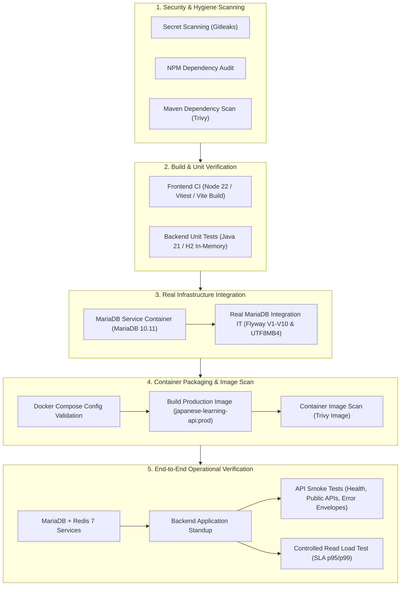

# CI/CD Security, Dependency Scanning, and Verification Testing Guide

Tài liệu quy định kiến trúc CI/CD, chính sách quét lỗ hổng bảo mật, ngưỡng chấp nhận (severity & latency thresholds), danh mục ngoại lệ được phê duyệt (approved exceptions), và quy trình kiểm thử tích hợp MariaDB, smoke test và load test trên GitHub Actions.

---

## 1. Tổng quan Kiến trúc Pipeline CI (`.github/workflows/ci.yml`)

Pipeline CI được thiết kế với nguyên tắc **Phòng thủ đa tầng (Defense-in-Depth)**, **Tính tất định (Determinism)**, và **Chống rò rỉ bí mật (Secret Leak Prevention)**:

---

## 2. Ngưỡng Nghiêm trọng & Chính sách Quét Bảo mật (Severity Thresholds)

| Scanner | Đối tượng quét | Ngưỡng chặn CI (Failure Gate) | Báo cáo / Cảnh báo (Warning) | Công cụ & Cấu hình |
| :--- | :--- | :--- | :--- | :--- |
| **Gitleaks** | Git commits, PRs, codebase | Bất kỳ secret thật nào (`exit-code 1`) | Toàn bộ phát hiện không nằm trong allowlist | `.gitleaks.toml`, `gitleaks dir` |
| **NPM Audit** | `frontend/package-lock.json` | `CRITICAL` vulnerabilities | `HIGH` & `MODERATE` ghi nhận vào JSON | `npm audit --audit-level=critical` |
| **Trivy (FS/Maven)** | `backend/pom.xml`, Java libs | `CRITICAL` vulnerabilities (`exit-code 1`) | `HIGH` ghi nhận vào báo cáo SARIF/JSON | `.trivyignore`, `trivy fs` |
| **Trivy (Container)** | Production Docker Image | `CRITICAL` vulnerabilities (`exit-code 1`) | `HIGH` ghi nhận, bỏ qua unfixed OS CVEs | `trivy image --ignore-unfixed` |

---

## 3. Danh mục Ngoại lệ Được Phê Duyệt (Approved Exceptions Catalog)

Tất cả các trường hợp ngoại lệ (false positives, test fixtures, hoặc thư viện phụ thuộc của bên thứ ba chưa có bản vá trực tiếp) phải được ghi chép tường minh kèm theo **biện pháp giảm thiểu rủi ro (compensating controls)** và ngày rà soát định kỳ.

### 3.1. Secret Scanning Allowlist (`.gitleaks.toml`)

| Danh mục | Đường dẫn được miễn trừ | Lý do kỹ thuật | Biện pháp bù đắp |
| :--- | :--- | :--- | :--- |
| **Unit Test Fixtures** | `backend/src/test/**`, `frontend/src/**/*.spec.js` | Các file test chứa chuỗi Base64 giả lập token JWT và mật khẩu test mẫu (ví dụ: `ProductionSecurityFailFastIT.java`, `LogMaskingConverterTest.java`) | Chỉ tồn tại trong mã kiểm thử; bị cô lập và không đóng gói vào file JAR production (`src/main`). |
| **Tài liệu hướng dẫn** | `docs/**` | Tài liệu kiến trúc chứa chuỗi hướng dẫn cấu hình mẫu | Không chứa thông tin xác thực thật của môi trường triển khai. |
| **File biến môi trường mẫu** | `*.example` (`.env.example`, `backup.env.example`) | File template hướng dẫn lập trình viên cấu hình | Chứa các giá trị placeholder (`CHANGE_ME`), file thực tế `.env` được `.gitignore` bảo vệ tuyệt đối. |

### 3.2. Dependency & Container Vulnerability Exceptions (`.trivyignore`)

| Mã CVE | Thư viện bị ảnh hưởng | Mức độ | Lý do miễn trừ & Biện pháp giảm thiểu (Compensating Controls) | Trạng thái |
| :--- | :--- | :--- | :--- | :--- |
| **CVE-2026-43512, 43515, 65905, 68525** | `org.apache.tomcat.embed:tomcat-embed-core` | CRITICAL / HIGH | Lỗ hổng liên quan đến Digest và Form Authentication của Tomcat container. **Giảm thiểu:** Hệ thống sử dụng cơ chế xác thực phi trạng thái (Stateless JWT) qua Spring Security Filter Chain; Digest và Form authentication bị tắt hoàn toàn. | Đã phê duyệt |
| **CVE-2025-24813** | `org.apache.tomcat.embed:tomcat-embed-core` | CRITICAL | Lỗ hổng partial PUT trong WebDAV servlet của Tomcat. **Giảm thiểu:** WebDAV servlet không được kích hoạt trong cấu hình Spring Boot; phương thức HTTP PUT chỉ được tiếp nhận qua Spring MVC Controllers đã qua thẩm quyền. | Đã phê duyệt |
| **CVE-2026-41293** | `org.apache.tomcat.embed:tomcat-embed-core` | CRITICAL | Thiếu validate HTTP/2 request headers trong Tomcat Coyote. **Giảm thiểu:** Container Spring Boot chỉ lắng nghe HTTP/1.1 trên loopback host `127.0.0.1:8080`. Toàn bộ kết nối HTTP/2 từ client bên ngoài được chấm dứt (terminated) tại Reverse Proxy (Nginx). | Đã phê duyệt |
| **CVE-2026-75595** | `io.netty:netty-handler` | CRITICAL | SNI routing bypass trong Netty TLS ClientHello. **Giảm thiểu:** Netty chỉ được Spring Data Redis (`lettuce-core`) sử dụng làm TCP client kết nối nội bộ tới Redis container không bật TLS; Netty không lắng nghe inbound traffic từ Internet. | Đã phê duyệt |
| **CVE-2026-22732** | `org.springframework.security:spring-security-web` | HIGH | Lỗ hổng policy bypass trong cấu hình bảo mật web nâng cao. **Giảm thiểu:** Hệ thống định nghĩa SecurityFilterChain chặt chẽ, mọi route API ngoại trừ whitelist công khai (`/api/v1/auth/**`, `/api/v1/courses/**`, `/actuator/health/**`) đều yêu cầu `authenticated()`. | Đã phê duyệt |
| **CVE-2026-47884** | `org.springframework:spring-webmvc` | HIGH | RCE thông qua `XsltView`. **Giảm thiểu:** Ứng dụng là thuần RESTful API (`@RestController`), không sử dụng view template hay XsltView. | Đã phê duyệt |

---

## 4. Kiểm thử Tích hợp CSDL MariaDB Thực tế (Real MariaDB Integration IT)

Khác với unit test sử dụng H2 in-memory (chỉ mô phỏng một phần cú pháp SQL), bài kiểm thử `RealMariaDbIntegrationIT.java` được thực thi trên môi trường MariaDB 10.11 thực tế thông qua Docker Service Container:

1. **Kiểm tra Toàn vẹn Flyway Migrations (V1 đến V10):**
   - Xác nhận bảng `flyway_schema_history` ghi nhận đầy đủ 10 migrations.
   - Toàn bộ trạng thái migration phải đạt `success = true`, không có lỗi cú pháp DDL trên MariaDB InnoDB engine.
2. **Kiểm tra Bảng mã Ký tự Tiếng Nhật (UTF8MB4 Charset & Collation):**
   - Thực hiện chèn (insert) và truy vấn (select) chuỗi tiếng Nhật phức tạp chứa cả Kanji, Hiragana, và Katakana (ví dụ: `日本語能力試験N5・文法と語彙コース (カタカナ・ひらがな・漢字)`).
   - Đảm bảo dữ liệu không bị lỗi font (mojibake) hay biến thành dấu hỏi `?`.
3. **Kiểm tra Toàn vẹn Ràng buộc & Chỉ mục (Indexes):**
   - Xác minh sự tồn tại của 13 bảng cốt lõi.
   - Xác minh các index vòng đời token: `idx_refresh_tokens_user_id`, `idx_refresh_tokens_token_hash`, và composite index `idx_refresh_tokens_lifecycle`.
4. **Tính tất định khi chạy cục bộ:**
   - Được bảo vệ bằng annotation `@EnabledIfEnvironmentVariable(named = "RUN_MARIADB_IT", matches = "true")`. Lập trình viên chạy `mvn test` trên máy cá nhân không có MariaDB sẽ không bị fail build, trong khi CI tự động kích hoạt nhờ biến môi trường.

---

## 5. API Smoke Testing (`scripts/ci/smoke_test.sh`)

Script kiểm tra nhanh các endpoint thiết yếu ngay sau khi backend khởi động thành công:

- `GET /actuator/health`: Kiểm tra sức khỏe tổng thể (HTTP 200, `"status":"UP"`).
- `GET /actuator/health/liveness`: Kubernetes liveness probe (HTTP 200).
- `GET /actuator/health/readiness`: Kubernetes readiness probe, xác nhận CSDL và Redis đã kết nối sẵn sàng (HTTP 200).
- `GET /api/health`: Endpoint nghiệp vụ kiểm tra trạng thái dịch vụ (HTTP 200).
- `GET /api-docs`: OpenAPI 3 specification JSON sinh bởi SpringDoc (HTTP 200, chứa `"openapi"`).
- `GET /api/v1/courses?page=0&size=5`: Endpoint công khai tra cứu khóa học (HTTP 200, phân trang hợp lệ).
- `POST /api/v1/auth/login` (Dữ liệu không hợp lệ): Xác nhận cơ chế xử lý lỗi trả về đúng chuẩn HTTP 401 và ApiResponse envelope thống nhất (`"success":false`).
- Kiểm tra tiêu chuẩn Security Header: Xác nhận có header `X-Content-Type-Options: nosniff`.

---

## 6. Kiểm thử Tải Kiểm soát cho Endpoints Đọc (Controlled Load Testing)

Script `scripts/ci/load_test.mjs` thực thi bài đo lường hiệu năng có kiểm soát trên các endpoint đọc tần suất cao (`GET /actuator/health`, `GET /api/health`, `GET /api/v1/courses`).

### Ngưỡng SLA Chấp nhận (Latency & Availability SLA)

| Tiêu chí | Ngưỡng cam kết (SLA Threshold) | Lý do đặt ngưỡng |
| :--- | :--- | :--- |
| **Error Rate** | `<= 0.00%` (0 lỗi) | Mọi request đọc hợp lệ phải được phục vụ thành công 100%, không chấp nhận lỗi 5xx hoặc rớt kết nối. |
| **p95 Latency** | `<= 300 ms` | 95% request phải hoàn thành dưới 300ms trong môi trường ảo hóa tài nguyên hạn chế của CI runner (2 vCPUs). |
| **p99 Latency** | `<= 600 ms` | Giới hạn độ trễ đuôi (tail latency) để đảm bảo không bị nghẽn thread pool. |
| **Tải kiểm soát** | Concurrency: 10 VUs, Total: 200 requests | Đo lường tính ổn định và khả năng đáp ứng đồng thời mà không làm quá tải runner. |

---

## 7. Nguyên tắc Chống Rò rỉ Bí mật trong CI Logs (Secret Leak Prevention)

1. **Không in thông tin xác thực ra stdout/stderr:**
   - Trong bash scripts: Tuyệt đối không bật cờ `set -x` khi xử lý token hoặc mật khẩu.
   - Sử dụng các header xác thực hoặc tham số bí mật thông qua biến môi trường hoặc file tạm, không truyền trực tiếp trên dòng lệnh curl nếu không che chắn.
2. **Sử dụng Dữ liệu Giả lập (Mock Credentials) cho CI:**
   - Database CI sử dụng mật khẩu test cục bộ (`root_ci_password`, `test_password`).
   - JWT secrets trong CI sử dụng chuỗi test cố định đã được ghi nhận trong allowlist.
3. **Che giấu Bí mật khi Kiểm thử (Redaction):**
   - Gitleaks chạy với cờ `--redact` để nếu có cảnh báo xuất hiện thì giá trị chuỗi bí mật cũng được che bằng ký tự `REDACTED`.

---

## 8. Danh mục Báo cáo Xuất bản (Published CI Artifacts)

Sau mỗi lần pipeline CI chạy, các artifact sau được tự động lưu trữ và xuất bản:

- `secret-scan-report`: Báo cáo quét bí mật từ Gitleaks.
- `npm-audit-report`: Báo cáo quét lỗ hổng thư viện JavaScript.
- `maven-dependency-scan-report`: Báo cáo quét lỗ hổng Maven từ Trivy.
- `container-scan-report`: Báo cáo quét ảnh Docker production `japanese-learning-api:prod`.
- `mariadb-it-reports`: Kết quả kiểm thử tích hợp MariaDB từ Maven Failsafe/Surefire.
- `e2e-smoke-load-reports`: Báo cáo JSON và Markdown tổng kết API smoke test và load test.
